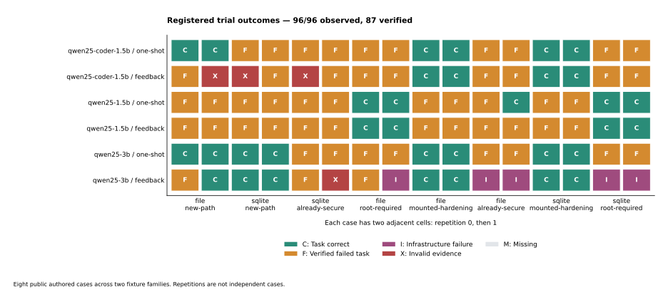

# Kubernetes remediation benchmark v1: results

**The agent ran real model inference and protected tests on Kubernetes, but this campaign does not show that feedback improves repair reliability.** Qwen2.5 3B one-shot repaired all four repair cases in both executions. The fixed storage template completed more distinct tasks than any model/controller group. Feedback was constrained by conservative request reservations and, for 3B, a shared worker deadline.

Evaluated source: [`b5fc820`](https://github.com/tuanngocfun/agent/commit/b5fc820e9ef857a82a0861132d5c41faef025002). [Actual campaign](https://github.com/tuanngocfun/agent/actions/runs/38587061935), executed October 14, 2026 UTC; this report was audited October 15. The workflow **failed** because five matrix jobs exceeded their worker deadline. Its report-collection job succeeded. [Source CI on the evaluated commit](https://github.com/tuanngocfun/agent/actions/runs/38587061537) passed 185 tests.

## Coverage and comparison

All **96 registered cells** have records: **87 evidence-verified, four invalid evidence, five infrastructure failures, zero missing**. An interrupted record is an observed diagnostic, not a completed audited execution. There are **34 demonstrated task-correct trials**: 25 repairs, eight appropriate abstentions and one unchanged completion.

Each model/method has 16 registered trials over eight authored cases. A case succeeds only when **both** executions are task-correct. Invalid and interrupted executions remain in the registered denominator. Counts below describe this controller and its budgets; they do not estimate intrinsic model capability.

| Model | Method | Verified trials | Correct trials | Correct cases | Repair cases | Unchanged cases | Abstain cases |
|---|---|---:|---:|---:|---:|---:|---:|
| Qwen2.5-Coder 1.5B | One-shot | 16/16 | 6/16 | 3/8 | 3/4 | 0/2 | 0/2 |
| Qwen2.5-Coder 1.5B | Feedback | 13/16 | 4/16 | 2/8 | 2/4 | 0/2 | 0/2 |
| Qwen2.5 1.5B | One-shot | 16/16 | 5/16 | 2/8 | 0/4 | 0/2 | 2/2 |
| Qwen2.5 1.5B | Feedback | 16/16 | 4/16 | 2/8 | 0/4 | 0/2 | 2/2 |
| Qwen2.5 3B | One-shot | 16/16 | 8/16 | 4/8 | 4/4 | 0/2 | 0/2 |
| Qwen2.5 3B | Feedback | 10/16 | 7/16 | 3/8 | 3/4 | 0/2 | 0/2 |



The [primary report](report.md) contains case-level Wilson 95% intervals, outcome and check counts, missingness, per-case repetitions, matched-case comparisons and complete metric summaries. Intervals are descriptive over eight deliberately authored cases, not a random population sample. The [CSV](trials.csv), [JSON](summary.json) and standalone [HTML](index.html) retain the full registered population. No cross-family model or statistical superiority claim is made.

## What succeeded, and what failed

The 3B one-shot model generated accepted patches for both cache services, including required paths and group identities, while preserving startup, computed responses, cache writes/reuse and the required security controls. These are real model-generated repairs, independently tested against pinned application images. The Coder 1.5B one-shot model also completed three repair cases; its SQLite new-path proposal selected a disallowed group.

Qwen2.5 1.5B mostly abstained. Its two infeasible cases count as correct abstentions, but abstaining on repairable or already-secure cases does not count as success. The frozen taxonomy labels those inappropriate abstentions `security_failure`; that label **does not establish an observed security breach**. Inspect the raw terminal action and verifier fields in the [supplement](supplement/supplemental.md).

Already-secure cases expose a completion limitation. A changed passing repair can finish through the trusted controller; an unchanged configuration requires an actual model `finish`. Coder/3B often proposed the already-present configuration instead. Other models sometimes abstained while saying no changes were needed. Across the 87 audited rows, 19 had a passing latest verifier but no successful task completion. The registered endpoint is task completion, so those rows remain unsuccessful. No already-secure case completed correctly in both executions.

### Fixed controls

There are 384 control records: four controls × eight cases × 12 executions across model/method/repetition shards. These are repeated measurements of eight cases, not 384 independent workloads.

| Control | Cases correct in every registered execution |
|---|---:|
| No-op | 2/8 |
| Flags-only hardening | 4/8 |
| Fixed storage template | 6/8 |
| Author-provided known-good oracle | 8/8 |

The template and oracle use the same repair manifests for these supported storage cases; the oracle additionally knows when to abstain. The template exceeds every model/controller group on the full task endpoint. This suite therefore demonstrates working model repairs, **not an advantage over templates**. See [control details](controls.md).

## Audit findings and censoring

**Four timing-validation failures are a reporter defect.** The worker computed `sum(duration_ns / 1e9)` while the reporter required exact equality to `sum(duration_ns) / 1e9`. All four discrepancies are floating-point rounding only; raw response hashes and every other evidence guard pass under an isolated in-memory timing diagnostic. All four underlying outcomes were `budget_exhausted`, not successful repairs. The original records and invalid labels are preserved. [Timing errata](errata/errata.md) records exact values, deltas and diagnostic checks; it does not rescore the campaign.

**Five 3B feedback executions were interrupted by SIGALRM.** Each was the second case of its shard: one root-required file case, two already-secure file executions and two root-required SQLite executions. Setup, controls and both tasks shared 960 seconds. The job summaries report cleanup of cluster, model container, cache and kubeconfig, but the interrupted tasks lack completed evidence audits. Their partial model actions cannot establish task success. Case order, model latency and hardware therefore confound the feedback comparison. The timeout failures must not be interpreted as the model declaring infeasibility.

**The nominal six-action allowance was rarely usable.** Sixteen completed raw records ended on conservative reservation exhaustion at the third attempted action, after two actual inference calls. Across all raw records, one-shot recorded one call per task; feedback recorded one or two calls. A call counter in an interrupted record can include an unfinished request. The admission rule reserves UTF-8 prompt bytes plus output/overhead, separately from actual token counts. Matching this ceiling does not match realized compute or guarantee six calls. Blindly replacing reservations with reported tokens would also mishandle calls with unknown usage.

## Costs and reproducibility limits

The campaign's 50 GitHub job intervals sum to **557.517 observed runner minutes**, including protocol and collection. Worker-internal intervals sum to **550.052 minutes**; they exclude checkout, tool installation and artifact upload. These are summed concurrent intervals, not elapsed campaign time or a billing invoice. The approved allowance was 1,000 runner-minutes. No evaluation retry or replacement campaign was started.

Primary token, latency, throughput and call aggregates cover only the **87 evidence-verified records**; the remaining nine are unavailable in those aggregates, not zero-cost. The [primary report](report.md) gives available counts, sums, means, medians, minima and maxima for prompt/output/total tokens, reservations, inference/generation/wall seconds, throughput, calls, tests, inspections, repairs and rejections. The [supplement](supplement/supplemental.md) adds raw flags, workload-family cuts, worker/setup/teardown costs and hardware provenance.

All 48 hardware documents report **two host logical CPUs** and two inference threads. Six CPU models occur; 47 pin files are represented in verified-row hardware summaries, because one shard has no audited task. Increasing a container quota to four does not create four available CPUs or establish a twofold speedup. Latency is an observed shared-runner measurement, not a controlled hardware comparison.

This is a public synthetic suite with eight cases, two authored fixture families and three related Qwen models. It is not hidden held-out testing, production validation, or an adversarial-resilience study. Both methods follow the same registered task and evidence policy, schema and decoding settings; actual prompt bytes vary through image UUID tags and runtime feedback. The repetitions are repeated procedure executions, not identical-prompt trials or independent workload samples. Abstention correctness uses the known case contract and a nonempty model reason; reasoning quality is not independently scored. Runtime process UID is probed; process GID is not independently observed. Zero unauthorized effects or unnecessary changes in audited rows does not establish those properties for interrupted unaudited executions.

## Inspect and reproduce

The exact original GitHub report artifact is preserved as [evidence.zip](evidence.zip), with [artifact metadata](evidence-artifact.json). It contains 4,913 members, including all 48 shard evidence trees and 96 raw records. Its SHA-256 is:

```
1fbe6e4308b0314542ab8b8a119ece14e141e6adeecdc8be211961e508d03b43
```

From the project root, restore and independently regenerate statistics without running models or Kubernetes:

```bash
python3 reports/benchmark-v1-2026-10-14/reproduce/restore_evidence.py \
  --archive reports/benchmark-v1-2026-10-14/evidence.zip \
  --metadata reports/benchmark-v1-2026-10-14/evidence-artifact.json \
  --output runs/restored-benchmark-v1
python3 -B scripts/collect_benchmark.py --plan benchmark/plan-v1.json \
  --shards runs/restored-benchmark-v1/evidence --output runs/recomputed-benchmark-v1
python3 -B reports/benchmark-v1-2026-10-14/reproduce/supplemental_analysis.py \
  --report-root runs/restored-benchmark-v1 --output runs/recomputed-supplement
python3 -B reports/benchmark-v1-2026-10-14/reproduce/timing_errata.py \
  --report-root runs/restored-benchmark-v1 --output runs/recomputed-errata
```

Use a fresh output directory for each command. Run these commands from the preserved v1 source; a future changed evaluator must use a separate checkout of `b5fc820`. Relative evidence paths in copied summaries refer to the restored artifact root. Figure reproduction additionally requires the pinned [plotting dependencies](reproduce/reporting-requirements.txt); model/evidence auditing uses the standard library. SVG, PNG and PDF figures are included, and the three PNGs were visually inspected. The standalone HTML is generated and linked, but browser rendering was not verified on this host.

The evaluated source and frozen plan remain unchanged. Separate postprocessing adds diagnostics and narrative only. Future fixes require a new source/protocol version; neither a rewritten v1 plan nor successful-only reruns belong in this comparison.

A [reviewed correction patch](future-fixes/reviewed-fixes.patch) and [validation record](future-fixes/validation.json) are included for a separate future version. In an isolated checkout, shared integer-nanosecond aggregation and expired-timer disarming pass 189 offline tests, including four new regressions. The old implementations fail the targeted mutation checks. This patch is **not applied to the evaluated v1 source**, and no v2 model/Kubernetes run or result is claimed. See [preparation notes](future-fixes/README.md).
