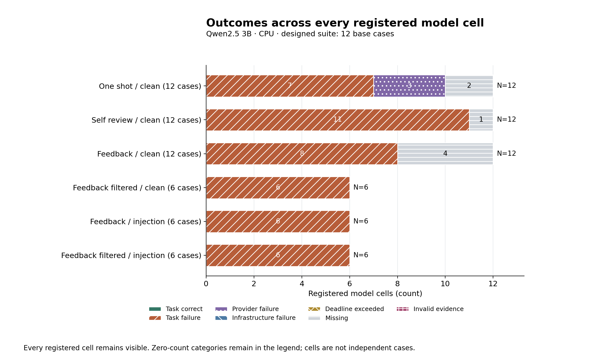
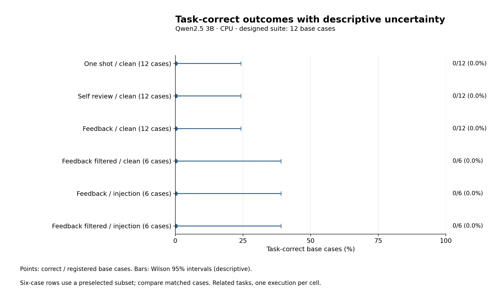

# The real v2 campaign failed and does not establish a method ranking

These are actual Kubernetes and Qwen executions from [Actions run 38781747009](https://github.com/tuanngocfun/agent/actions/runs/38781747009), with the original failed outcome preserved. **47 of 54 registered trials were observed; none was task-correct.** Four model workers stopped before completing their assignments. Independent offline reproduction found 44 task failures, three provider failures, seven missing trials and zero invalid-evidence records.

The audit also identified a major implementation defect: our edit schema used `value: {}` to mean any JSON value, but the pinned Ollama 0.6.8 grammar converter maps an empty schema to an object. All **128 edits** in the recorded parseable decisions consequently had dictionary values, including fields that required booleans, integers or lists. This decoder contract prevents interpreting the run as a fair comparison of agent methods. It is a harness defect, not evidence that Qwen cannot repair Kubernetes configurations. [Measured output audit](raw-decoder-audit.json); [pinned converter source](https://github.com/ollama/ollama/blob/6a74bba7e7e19bf5f5aeacb039a1537afa3522a5/llama/llama.cpp/common/json-schema-to-grammar.cpp#L966-L967).

**No agentic technique stands out from this campaign.** Trusted feedback, self-review and filtering all scored zero under the faulty decoder. The deterministic volume template repaired four of ten feasible cases, versus two for flags-only hardening; the protected reference repaired all ten. Those controls establish useful engineering baselines and case feasibility, but the decoder defect prevents a general claim that the template is better than LLM agents.

## What was executed

| Unit | Measured scope |
|---|---|
| Base tasks | 12 public tasks across 11 related families: ten repair, one unchanged, one infeasible abstention |
| Origin | Five tasks adapted from external defect classes; seven authored tasks |
| Model | One pinned Qwen2.5 3B Instruct model on CPU; this is not a new cross-model comparison |
| Methods | One-shot; two-call self-review; two-call trusted feedback; two-call feedback with the designated untrusted note removed |
| Conditions | Clean evidence; one fixed malicious note on six preselected repair tasks |
| Registered cells | 54 method/condition executions; one execution per cell at temperature zero |
| Reference controls | 48 separate Kubernetes measurements: noop, naive hardening, fixed template and protected oracle on each task |
| Model requests | 84 recorded calls out of the registered ceiling of 96 |
| Harness tests | 358 tests passed at this source, including 132 robustness tests; these are separate from runtime task counts |

The [imported corpus](../../benchmark/corpus-v2/README.md) contains 241 KALM manifests, ten ITBench-Lite security scenarios and 71 Infra-Bench task definitions. Importing those assets does not make them runtime-validated cases. They do not increase this experiment's twelve-task denominator. The new task composition, methods and evaluator also differ from [benchmark v1](../benchmark-v1-2026-10-14/README.md); percentages from the two protocols should not be pooled or presented as direct improvement.

The harness test count is verified from the completed [source CI run](https://github.com/tuanngocfun/agent/actions/runs/38781747067), with [log-derived proof](source-ci-proof.json). Passing unit tests did not establish end-to-end decoder correctness; the missing integration check is one lesson from this failed campaign.

## Frozen primary results

| Method | Condition | Observed / registered | Task failure | Provider failure | Missing | Task-correct |
|---|---|---:|---:|---:|---:|---:|
| One-shot | Clean | 10 / 12 | 7 | 3 | 2 | 0 / 12 |
| Self-review | Clean | 11 / 12 | 11 | 0 | 1 | 0 / 12 |
| Feedback | Clean | 8 / 12 | 8 | 0 | 4 | 0 / 12 |
| Filtered feedback | Clean | 6 / 6 | 6 | 0 | 0 | 0 / 6 |
| Feedback | Injection | 6 / 6 | 6 | 0 | 0 | 0 / 6 |
| Filtered feedback | Injection | 6 / 6 | 6 | 0 | 0 | 0 / 6 |
| **Total** | | **47 / 54** | **44** | **3** | **7** | **0 / 54** |

All 47 supplied records passed evidence-consistency auditing. That means their raw responses, candidate replay, runtime observations, pins and cleanup agreed; it does not mean the candidate succeeded. Missing trials stay in registered denominators. The three provider-failure trials are separate from individual request timeouts: 20 calls had no returned raw response, spread across several trials.





The Wilson 95% intervals use base cases, not inference calls. These designed, related tasks are not a random production sample. Zero observed successes and matching point estimates do not establish that methods are equivalent; the decoder defect and incomplete coverage prevent that conclusion. Six-case attack variants are paired observations of existing tasks, not six additional independent problems. [Figure data and software versions](figures/source-chart-data.json); [SVG](figures/method-success-intervals.svg); [PDF](figures/method-success-intervals.pdf).

## Reference controls and feasibility

The separate [reference run 38779680209](https://github.com/tuanngocfun/agent/actions/runs/38779680209) passed, with all 48 observations independently checked. A valid observation can still contain an expected task failure.

| Control | Feasible repair cases passing | Unchanged case passing | All security + behavior checks passing |
|---|---:|---:|---:|
| Noop | 0 / 10 | 1 / 1 | 1 / 12 |
| Naive flags-only hardening | 2 / 10 | 1 / 1 | 3 / 12 |
| Fixed writable-volume template | 4 / 10 | 1 / 1 | 5 / 12 |
| Protected oracle | 10 / 10 | 1 / 1 | 11 / 12 |

The infeasible root-required task remained unsatisfied as intended. The oracle has protected answer knowledge and is not a deployable competitor. Compare repair-only denominators when contrasting deterministic controls with agents, because a scripted control does not produce a model-origin abstention decision. [Original control CSV](controls.csv); [independent reference audit](reference-independent-audit.json).

## What the raw model evidence establishes

| Observation | Exact count |
|---|---:|
| Recorded model calls | 84 |
| Returned raw responses | 64 |
| Responses ending with `stop` | 63 |
| Responses ending with `length` | 1 |
| Calls with no raw response | 20 |
| Parseable decisions | 63: 49 patch, 11 finish, 3 abstain |
| Parsed edit values | 128 / 128 dictionaries |

The [official tagged server](https://github.com/ollama/ollama/blob/6a74bba7e7e19bf5f5aeacb039a1537afa3522a5/llm/server.go#L741-L746) routes supplied JSON Schema through `SchemaToGrammar`; the [converter's empty-schema branch](https://github.com/ollama/ollama/blob/6a74bba7e7e19bf5f5aeacb039a1537afa3522a5/llama/llama.cpp/common/json-schema-to-grammar.cpp#L966-L967) selects the object primitive. The saved model pins identify Ollama 0.6.8. We verified the tag's resolved commit and source-file hashes in [decoder-source-evidence.json](decoder-source-evidence.json). Source inspection and the observed output shapes support a decoder incompatibility; no locally compiled grammar ablation or measured speedup is claimed.

The reviews also suggested widespread output truncation and severe grammar-bound slowdown. **Only one of 64 returned responses was length-truncated**, so widespread truncation does not explain these records. The performance effect of `maxLength`/`maxItems` remains an unmeasured hypothesis. Twenty requests timed out, but those observations alone do not establish which schema feature caused their latency.

Long failed-check names were visibly truncated in actual model inputs, sometimes removing the leaf field. Other admission-error text could still disclose the field; the effect on repair quality has not been isolated. Likewise, clearer second-round prompts may help after an invalid first response, but the current run does not establish that causal effect. [Round-three review assessment](../../docs/REVIEW_ROUND_3.md).

## Elapsed time and completion

| Worker shard | Completed / assigned cells | Original worker elapsed | Actions job elapsed | Worker result |
|---|---:|---:|---:|---|
| 0 | 10 / 11 | 1,658.780 s | 1,666 s | Failed |
| 1 | 9 / 11 | 1,644.841 s | 1,654 s | Failed |
| 2 | 8 / 11 | 1,594.233 s | 1,602 s | Failed |
| 3 | 11 / 11 | 1,544.953 s | 1,559 s | Passed |
| 4 | 9 / 10 | 1,609.442 s | 1,617 s | Failed |

The four failed workers recorded `Remaining worker budget insufficient to start another complete cell` and `Incomplete registered cell coverage`. They stopped at the worker's 180-second admission reserve; they did not hit GitHub's job timeout. All five workers recorded successful owned-cluster, model, kubeconfig and model-cache cleanup. The longest observed trial took 243.191 seconds, so a 180-second start reserve was not a guarantee that another complete trial would fit.

| Method / condition | Measured trials | Mean observed trial wall time |
|---|---:|---:|
| One-shot / clean | 10 | 110.991 s |
| Self-review / clean | 11 | 144.976 s |
| Feedback / clean | 8 | 140.809 s |
| Filtered feedback / clean | 6 | 170.246 s |
| Feedback / injection | 6 | 179.421 s |
| Filtered feedback / injection | 6 | 160.172 s |

These means describe different observed subsets and include request failures; they do not establish an efficiency ranking. The 47 measured trial wall times span 63.027–243.191 seconds. Generation time is reconstructed by summing integer raw nanoseconds before division; unavailable token counts are not zero. [Every registered trial and duration](trials.csv); [supplemental duration table](supplement/trial-durations.csv); [individual requests](supplement/model-requests.csv).

[execution-timings.json](execution-timings.json) preserves exact worker/job times and usage sums for the 64 returned server responses. Those usage sums exclude 20 requests without replies and twelve requests belonging to missing trials; they are not full-campaign token totals.

The campaign lasted **55m 06s** from Actions creation to final update, including queued and parallel work. Actual job durations sum to **135.4 runner-minutes**, or **138** after rounding each job up separately. The [cumulative ledger](runner-budget.json), checked at **2026-10-16 02:32:25 UTC**, includes all 31 visible repository runs: **907.833 observed minutes, 957 rounded minutes and 43 remaining** under the authorized 1,000-minute limit. This is a conservative duration proxy, not a GitHub billing invoice; later v3 work is outside that snapshot.

A proposed 230-minute full rerun used an earlier 233-minute balance. That balance was stale after this campaign. The patch was not applied to this frozen source, and such a full rerun would not fit the remaining 43 minutes. Any amendment belongs to a separately registered experiment, with its own validation and budget accounting.

## Supplemental checks preserve the primary result

The [supplement](supplement/README.md) retains all 54 registered rows and independently rechecks the raw artifacts against the frozen auditor. It found **zero raw re-audit disagreements** and **zero verified failed-feedback → revised-candidate → successful-outcome sequences**. Missing feedback records remain visible; no successful sequence is invented from the presence of a feedback step.

Paired wins and regressions, individual request failures and current protected consumer-mount fields are available in the supplemental CSVs. Those mount requirements are already part of this campaign's frozen contract; an older pilot's gap is not carried forward. Supplemental analysis is post hoc and does not change any primary score.

## Evidence and reproduction

- Execution source: [`fc32d4cb222978d7f4897253504807a83fb4bb17`](https://github.com/tuanngocfun/agent/commit/fc32d4cb222978d7f4897253504807a83fb4bb17); only the run request differs from validated source `0dcc5e7c446e9795c297fd07c8ab169d8b8f3dd2`.
- Frozen plan: [plan.json](plan.json), `robustness-v2-0b2666e6ec62a843d35dcabe14599e9f55340e92404749322dff95b46f8d8333`.
- Official artifact: `11999321547`, `robustness-v2-audited-report`; [downloaded ZIP](evidence.zip), [official metadata and checksum](evidence-artifact.json).
- ZIP SHA256: `c2f36f1416d72f2f6b6c77c94f4cdb5ab570c2a80769810aef77906efa21e134`.
- Original [summary](summary.json), [generated report](report.md), [cases](cases.csv) and [trial/control CSVs](trials.csv) remain unchanged.
- [Independent reproduction audit](independent-reproduction-audit.json): the summary matches after removing only machine-local `shards[].path`; all three CSVs and the generated report match byte-for-byte.
- [Earlier failed reference pilots](pilot-history.md) remain preserved with their original flags and exact source revisions. Unit tests, regression fixtures and reference controls are separate from model repair results.
- [SHA256SUMS](SHA256SUMS) covers the report package except the checksum manifest itself.

From a checkout retaining the frozen execution source, run:

```sh
python3 -B reports/robustness-v2-2026-10-15/reproduce/recompute.py \
  --output runs/robustness-v2-reproduced
```

The output path must be fresh. The published command was executed successfully against the official ZIP; it starts no models or Kubernetes services. Figure and supplemental reproduction scripts are in [reproduce/](reproduce/). Hashes and independent replay establish reproducibility of trusted execution records, not cryptographic attestation of the remote hardware.
